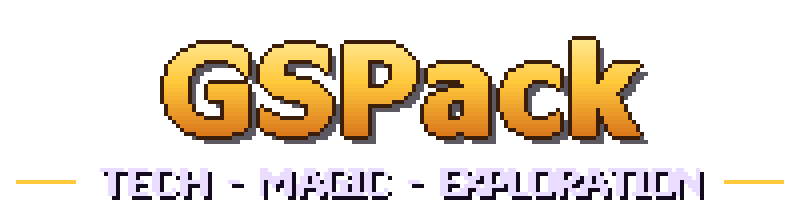

<p align="center">
  
</p>

A Minecraft **26.1.2 NeoForge** modpack built around tech, magic and exploration: Mekanism, Applied Energistics 2, Oritech, Railcraft Reborn, Mystical Agriculture, Apotheosis, Thaumaturge, Equivox, Roots Classic, EvilCraft, Allthemodium, The Twilight Forest, The Aether II, Stellaris, Aquaculture and more. The full mod list is in [MODS.md](MODS.md).

This repository holds the pack's configuration: everything except the mod jars. The pack itself is published on [CurseForge](https://www.curseforge.com/members/steef_an/projects).

## Running a server

Server files are available through **[GSPackServerInstaller](https://github.com/steefan1998/GSPackServerInstaller)**. It builds a ready-to-run GSPack server on Windows or Linux: it downloads the mods (without the client-only ones), copies the configs, installs NeoForge and Java, and writes start scripts with 8 GB RAM.

```powershell
# Windows: or just double-click Build-ServerPack.bat
powershell -ExecutionPolicy Bypass -File .\Build-ServerPack.ps1 -AcceptEula
```
```bash
# Linux
./build-serverpack.sh --accept-eula
```

The server ends up in `GSPackServer/`; start it with `start.bat` or `start.sh`. See the [installer README](https://github.com/steefan1998/GSPackServerInstaller#readme) for all options.

## What's in here

| Path | Contents |
|---|---|
| `config/` | All mod configs, including the FTB Quests quest book (`config/ftbquests/quests`) |
| `kubejs/` | KubeJS scripts and assets, including the quest book textures (`kubejs/assets/gspack`) |
| `tools/` | Scripts that generate the quest book and sync this repo with a local instance |
| `MODS.md` | Generated list of every mod and version in the pack |

## The quest book

1,484 quests in English, in 29 chapters:

- **Start:** Welcome, Getting Started (vanilla progression), GSPack Progression (a map of the whole pack with dependency lines)
- **Technology:** Mekanism, Applied Energistics 2 (with an AE2 Add-ons section), Oritech, Tinkers' Construct, LTX Industries, Railcraft Reborn, Utilities, Just Dire Things
- **Magic & Farming:** Mystical Agriculture, Seed Codex (every seed that loads in the pack, including GSPack's own Allthemodium and mod-ore seeds), Apotheosis, Thaumaturge, Equivox, Roots Classic, EvilCraft
- **Exploration & Dimensions:** Allthemodium, Aquaculture 2, The Aether II, The Twilight Forest, Stellaris, Dungeons & Structures, Wildlife
- **Storage & Building:** Storage, Building
- **Endgame:** Endgame: Infinity, Trophy Checklist (every trophy ingredient on rings around the trophy)

## Endgame: craftable creative items (KubeJS)

The pack's end goal is the **Trophy of Infinity**. KubeJS adds five cores, each made from the hardest items of one pillar of the pack:

| Core | Made from |
|---|---|
| Technological Core | Antimatter, Super AI Chips, Quantum Processors, Infinite Control Circuit |
| Arcane Core | Void Metal, Godforged Pearls, Red Matter, Primordial Pearl, Occultism tier-4 Storage Stabilizer |
| Verdant Core | Insanium, Nether Star Seeds, Neptunium, Unobtainium Seeds |
| Dimensional Core | Unobtainium-Vibranium Alloy, Twilight boss trophies, Gravitite, Piglich Heart |
| Cosmic Core | Novite, Stellaris boss trophies, Nether Star |

The five cores make a **Creative Singularity**. Every creative item needs one: creative energy cubes, tanks and bins (Mekanism), creative cells (AE2, Powah), creative storage (Oritech), Creative Essence, Infinity upgrades and more. Eight creative items plus a singularity make the trophy.

In the quest book, each core only unlocks once you've finished the final quests of the matching chapters.

Scripts: `kubejs/startup_scripts/gspack_endgame_items.js`, `kubejs/server_scripts/gspack_endgame_recipes.js`, `kubejs/client_scripts/gspack_endgame_tooltips.js`. Item textures are generated by `tools/make-item-textures.ps1`.

## Allthemodium alloys (KubeJS)

`kubejs/server_scripts/gspack_allthemodium_alloys.js` lets you fuse the Allthemodium metals in a crafting table: 2 + 2 ingots (or dusts) of two metals make 2 alloy ingots (or dusts), and alloy dust smelts into the ingot.

## Extra Mystical Agriculture crops (Mystical Customization + KubeJS)

`config/mysticalcustomization/crops` adds 19 crops: Allthemodium, Vibranium and Unobtainium, and 16 ores from other mods (Stellaris, The Aether II, EvilCraft, LTX Industries, Occultism, AllTheOres, Just Dire Things, Aquaculture). Their items are `mysticalagriculture:<name>_seeds` and `mysticalagriculture:<name>_essence`. `kubejs/server_scripts/gspack_mystical_seeds.js` turns the essence back into the resource and adds the Allthemodium, Vibranium and Unobtainium Crux blocks (registered in `kubejs/startup_scripts/gspack_crux_blocks.js`) that the three ATM crops need under their farmland.

## Recipe fixes (KubeJS)

- `kubejs/server_scripts/gspack_compressed_fixes.js`: a recipe for the All The Compressed Antimatter Block (9 Antimatter Pellets), and Compressed Osmium / Steel from any mod's block.
- `kubejs/server_scripts/gspack_broken_recipe_fixes.js`: re-adds the Capacitor Additions and Grinding Ball Additions recipes, which use an ingredient format that 26.1 no longer reads.

## Material unification (KubeJS + datapack)

Many mods make the same metals, dusts and plates. GSPack keeps one item per material: Minecraft first, then AllTheOres, then Mekanism, then the mod the material comes from.

| File | What it does |
|---|---|
| `kubejs/startup_scripts/gspack_unify_table.js` | The table (113 materials), in a startup script because only startup scripts may write `global` |
| `kubejs/server_scripts/gspack_zz_unify.js` | Every recipe outputs the preferred item and accepts any mod's version |
| `kubejs/client_scripts/gspack_unify_hide.js` | Hides the duplicates in JEI (raw materials and gems stay visible) |
| `kubejs/data/*/loot_table/blocks/` | Ores of other mods drop the AllTheOres materials (written by `tools/make-ore-loot.ps1`) |
| `kubejs/data/*/neoforge/biome_modifier/` | Ores that AllTheOres also has no longer generate |
| `kubejs/server_scripts/gspack_zz_unify_convert.js` | Converts duplicates in player inventories and opened chests |
| `kubejs/server_scripts/gspack_zz_unify_blocks.js` | Replaces duplicate ores and material blocks in existing chunks when they load |
| `tools/convert-world.ps1` | Converts a whole world offline, while the server is stopped |

Quest tasks for these materials accept every mod's version automatically (the quest builder turns them into tag tasks).

### Converting an existing world

Stop the server (or close the game), then run:

```powershell
powershell -ExecutionPolicy Bypass -File tools\convert-world.ps1 -World "<path to the world>" -DryRun
powershell -ExecutionPolicy Bypass -File tools\convert-world.ps1 -World "<path to the world>"
```

`-World` takes a world or a server folder. The id tables are built in, so any old world works; a GSPack 0.5 `kubejs` folder next to the world is used instead when there is one. After changing the unification table, refresh the built-in copy with `-UpdateBuiltIn`. PowerShell 7 runs it on Linux (`pwsh -File convert-world.ps1 -World ./server`). Changed files are copied to `<world>\gspack-convert-backup` first; delete that folder once the world works.

## Cross-mod recipes (KubeJS)

`kubejs/server_scripts/gspack_crossmod_recipes.js` swaps one ingredient in eight key recipes for an item from another mod (for example steel in the AE2 Inscriber, a Mekanism Steel Casing in Oritech's Basic Generator). The new ingredient always comes from a mod that is reached earlier, so nothing is locked. The full list is in [CHANGELOG.md](CHANGELOG.md).

## Quest stages (KubeJS)

FTB Quests can't check item tags on its own here, so `kubejs/server_scripts/gspack_quest_stages.js` gives players a stage when a condition is met, and the quest uses a stage task (`stage:<name>` in `tools/content`, FTB Quests type `gamestage`). Used for **Punch a Tree** (16 logs of any kind).

Every chapter has a pixel-art header banner and section labels, rendered by the build script.

### Editing quests

The quest files are **generated**. Do not edit `config/ftbquests/quests` by hand. Edit the chapter scripts in `tools/content/` instead, then rebuild:

```powershell
powershell -ExecutionPolicy Bypass -File tools\build-quests.ps1
```

This writes `config/ftbquests/quests` (FTB Quests 26.1 JSON5 format) and `kubejs/assets/gspack/textures/quests`. Quest IDs are derived from the quest keys, so rebuilding keeps player progress.

Pass `-ItemList <file>` (one `namespace:id` per line, dumped from the mod jars) to check that every item, entity, structure, biome and dimension ID in the quests exists.

### Syncing with an instance

Both scripts use the **GSPack Dev Build** instance (`D:\CurseForge\Instances\GSPack Dev Build`) by default. Pass `-Instance <path>` to use another one.

```powershell
# Install the quest book and KubeJS from this repo into the instance (add -WhatIf to preview)
powershell -ExecutionPolicy Bypass -File tools\sync-to-instance.ps1
```

Then run `/ftbquests reload` in-game and press F3+T to reload the textures. Restart the game if KubeJS startup scripts changed.

```powershell
# Copy config/kubejs from the instance into this repo and refresh MODS.md
powershell -ExecutionPolicy Bypass -File tools\sync-from-instance.ps1
```

## Main menu (FancyMenu)

A custom title screen: a pixel-art dusk background with floating islands, the GSPack logo, gold-trimmed buttons and a GitHub button. Realms is hidden.

- Layout: `config/fancymenu/customization/gspack_title_screen.txt` (generated by `tools/make-menu-layout.ps1`)
- Textures: `config/fancymenu/assets/gspack` (generated by `tools/make-menu-textures.ps1`)

## Changelog

- [CHANGELOG.md](CHANGELOG.md): what changed in each version (quests, KubeJS, tools), written by hand.
- [MOD-CHANGELOG.md](MOD-CHANGELOG.md): every mod change per version, generated.

For each new version, run:

```powershell
powershell -ExecutionPolicy Bypass -File tools\track-mods.ps1 -Version 0.8
```

This saves a snapshot of all mods in `modlists/<version>.json` and lists what was added, removed and updated since the previous version.

## Release 0.7 additions

The 0.7 quest book has 1,720 quests across 36 chapters, including Farming, Mob Hunting Board and Neo Vitae. Mekanism separates circuits, alloys and installers; Utilities groups quests by mod. Eleven reward tables have 69 additional entries.

All players can use /mastery to view completed chapters and /mastery player <player> to inspect another online player. Welcome explains the commands. See [mastery](docs/MASTERY.md), [EMC policy](docs/EMC.md) and the [in-game test checklist](docs/DEV-TEST-CHECKLIST.md). Restart after installing the silicon and EMC changes.

Download and update GSPack through [CurseForge](https://www.curseforge.com/members/steef_an/projects). GitHub releases provide the changelog; pack downloads are distributed through CurseForge.
